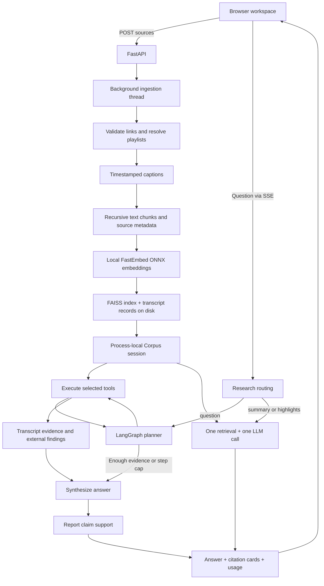

# VidSense: project and codebase deep dive

Companion documents: [tradeoffs and audit](<C:/Users/saksh/OneDrive/Desktop/vidsense-gpt/docs/interview/02-design-tradeoffs-and-audit.md>), [interview practice](<C:/Users/saksh/OneDrive/Desktop/vidsense-gpt/docs/interview/03-interview-questions.md>), [revision sheet](<C:/Users/saksh/OneDrive/Desktop/vidsense-gpt/docs/interview/04-revision-sheet.md>).

## 1. Understand the project before the libraries

VidSense reduces the work of finding information inside long YouTube videos. A user creates a collection from videos or playlists, then asks a question, requests an overview, or asks for useful moments. The output includes an answer and source cards that link into the videos.

The actual input being analyzed is **timestamped caption text**. The application does not download and analyze video frames, perform OCR on slides, recognize objects, or transcribe audio itself. Its intelligence is limited to what the transcript and optional web snippets make available. A diagram shown silently on screen is invisible to this pipeline.

The important engineering problems are:

1. Turn messy source links into a usable collection.
2. Retrieve the right evidence without sending every transcript to an LLM.
3. Gather evidence from several videos when one retrieval is inadequate.
4. Preserve where the evidence came from.
5. Distinguish what a video says from whether its claim is true externally.
6. Measure answer quality, tool behavior, cost, and latency.
7. Serve this behind a responsive, resource-bounded web application.

An interview description should therefore connect each library to a problem. Saying only “I used LangChain, FAISS, and Gemini” omits the architecture.

## 2. Three implementations coexist

| Implementation | Entry point | Scope | Current role |
|---|---|---|---|
| Original single-video system | `youtube_rag_system.py` | Single transcript, RAG Q&A, summary, topic extraction, chapter detection | Legacy module; excluded from the production container |
| Multi-video research interface | `app.py` | Shared corpus/agent, settings, full trajectory, baseline comparison, evaluation dashboard | Optional Streamlit interface |
| Customer web application | `api.py` + `frontend/` | Temporary collections, background ingestion, questions, summaries, highlights, SSE | Containerized portfolio application |

The current package is `vidsense/`. It does not import the legacy BERT module. BERT clustering and automatic chapters are not features of the current customer frontend. Streamlit shares the research components, but its UI does not have the web app's summary/highlight action buttons or its API session/rate-limit layer.

This matters if an interviewer has read an older resume description. Clarify which generation you are describing.

## 3. The architecture



There are two distinct pipelines:

- **Ingestion/indexing:** pay the cost of captions, chunking, and document embeddings once, then reuse the collection/index.
- **Research:** embed a question or tool query, retrieve evidence, invoke the LLM, and return an answer.

There is a third, developer-only workflow: **evaluation**, which runs research systems over fixed tasks and scores them. Evaluation does not run automatically for every user question.

## 4. What happens when a customer creates a collection

Relevant code: [API lifecycle](<C:/Users/saksh/OneDrive/Desktop/vidsense-gpt/api.py:264>), [source resolver](<C:/Users/saksh/OneDrive/Desktop/vidsense-gpt/vidsense/sources.py:123>), [corpus builder](<C:/Users/saksh/OneDrive/Desktop/vidsense-gpt/vidsense/corpus.py:241>).

### 4.1 Browser request and initial state

The source modal accepts an optional name and lines of YouTube links. JavaScript sends JSON to `POST /api/corpora`. The server validates the request, creates a UUID4 hex corpus ID, inserts a session with `status="processing"`, starts a daemon thread, and returns HTTP **202 Accepted**.

202 means the request has been accepted for work; it does not mean ingestion is complete. The session exists before expensive work begins, so the browser can poll its progress immediately.

The browser stores only the active corpus ID in `localStorage`. That lets a refresh reconnect to a still-existing session. It does not persist transcripts in the browser or recreate server sessions after a restart.

The browser polls `GET /api/corpora/{id}` every 1.2 seconds while status is `processing`. It renders phases such as source resolution, caption fetching, and index building. There is no percentage-based embedding progress.

### 4.2 Validation and source resolution

`split_inputs()` accepts multiple strings, splits newlines and commas, trims whitespace, and discards empty items. The source boundary checks recognized YouTube hostnames; unrelated URLs become `invalid` source entries rather than aborting all usable links.

Supported video parsing includes `/watch?v=...`, `youtu.be/...`, `/embed/...`, `/v/...`, and `/shorts/...`. The low-level video-ID helper accepts an 11-character bare ID, but customer source resolution requires a supported URL hostname, so bare IDs are not a customer input feature.

Playlist parsing recognizes `list=` on `/playlist` and `/watch`. A shared video link containing both `v=` and `list=` is therefore handled as a **playlist**, with playlist precedence. A `youtu.be` link's playlist context is not recognized by this playlist helper.

Local resolution uses `yt-dlp` without downloading media:

- Individual video metadata: `skip_download=True`, `noplaylist=True`.
- Playlist metadata: flat extraction, so it does not fully resolve/download each video.
- Fetch one entry beyond the remaining limit to detect clipping.

Flat playlist extraction trades detailed per-video metadata for speed. That is consistent with how the upstream library describes flat playlists. [yt-dlp documentation](https://github.com/yt-dlp/yt-dlp#usage-and-options).

If direct metadata fails, `_oembed_metadata()` asks YouTube's lightweight metadata endpoint with a 15-second timeout. If that also fails, the title falls back to the video ID. Failure to fetch a friendly title does not inherently prevent transcript ingestion.

Managed resolution uses Supadata playlist endpoints and bounded oEmbed title lookups with at most eight threads. The provider's `videoIds`, `shortIds`, and `liveIds` are concatenated and deduplicated; this may not preserve the original interleaving of a mixed-format playlist.

### 4.3 Deduplication, provenance, and partial success

The resolver keeps video IDs in first-seen order and retains the first title/provenance. The resulting spec contains:

```json
{
  "video_id": "aircAruvnKk",
  "title": "But what is a neural network?",
  "source_url": "https://www.youtube.com/watch?v=aircAruvnKk",
  "source_kind": "video",
  "playlist_id": null
}
```

An invalid source, duplicate, inaccessible playlist, or clipped playlist is recorded separately in `sources`, with statuses, counts, and errors. A usable collection continues despite these issues.

The default limit is **50 unique video specs across the collection**, including individual video links. Despite the variable name `MAX_PLAYLIST_VIDEOS`, this is not just a limit on each playlist.

The builder deduplicates again because manifests and programmatic callers can bypass the customer resolver. That protects the shared indexing boundary.

The final API state is:

- `ready`: usable corpus with no reported partial-import issue.
- `partial`: usable corpus with skipped transcripts or invalid/error/limited source entries.
- `error`: no usable collection or fatal indexing/loading failure.

A duplicate source alone does not make the collection partial. A `partial` corpus can be researched. The list of ready videos and skipped videos is returned as `video_statuses` for the library UI.

### 4.4 Transcript provider selection

The direct path calls `YouTubeTranscriptApi().fetch(video_id).to_raw_data()`. It retrieves existing manual or generated captions; it does not run speech recognition. Because no language list is passed, the installed library defaults to English. There is no app language selector or explicit translation policy. The upstream library documents both caption access and cloud-IP blocking. [youtube-transcript-api README](https://github.com/jdepoix/youtube-transcript-api).

Managed selection is explicit:

| Setting | Behavior |
|---|---|
| `direct` | Direct YouTube caption fetching |
| `supadata` | Managed fetching; a key is required |
| `auto` with a managed key | Prefer managed fetching immediately |
| `auto` without a managed key | Use direct fetching |

`auto` is a selection policy, not a “try direct, then fail over” sequence. A managed request failure does not fall back to direct access.

Managed transcript content is normalized to `{text, start, duration}`. Supadata offsets and durations are milliseconds, so the adapter divides by 1000, clamps negative values to zero, skips blank entries, and treats missing durations as zero.

The Supadata client uses one process-wide lock for playlist and caption requests. The lock remains held during the network request, and a 1.1-second wait is enforced after the previous request finishes. This serializes requests and is stricter than merely spacing their start times. It retries HTTP 429 once, maps common errors to concise messages, and uses a default 90-second request timeout.

The direct caption path and `yt-dlp` path do not receive that configurable timeout. The provider timeout does not impose an overall time budget on a 50-video job.

Per-video caption failures are collected as skipped records. All failed captions means the builder raises an error. Partial failure means indexing proceeds with the usable transcripts.

## 5. The corpus data model

Relevant code: [VideoRecord and Corpus](<C:/Users/saksh/OneDrive/Desktop/vidsense-gpt/vidsense/corpus.py:29>).

`VideoRecord` holds ID, title, segment list, original source URL/type, and optional playlist ID. `full_text` joins segment text with one space. `duration` currently returns the **start of the last caption**, rather than `start + duration`; it is an approximate duration display, not authoritative media duration.

`Corpus` holds:

- A dictionary of `VideoRecord` objects, keyed by video ID.
- One unified FAISS vector store for all usable videos.
- Skipped video records, input-source records, and warnings.

`resolve_video_id()` tolerates planner mistakes: an exact title, case-insensitive title, or substring title can resolve to a real ID. That improves robustness when an LLM fills a `video_id` argument with a title. Ambiguous substring matches choose the first match, which is a tradeoff worth mentioning.

`Corpus.search()` performs semantic similarity search over the entire corpus or applies a video metadata filter. `Corpus.retriever()` exposes a LangChain retriever interface but the current agent tools directly call `search()`.

The collection is the unit of retrieval isolation. Each collection has its own `Corpus` and index; a user-selected corpus does not search every customer's transcripts. Collection IDs are possession-based access, however, rather than authenticated user ownership.

## 6. Chunking, timestamps, embeddings, and FAISS

Relevant code: [chunking](<C:/Users/saksh/OneDrive/Desktop/vidsense-gpt/vidsense/corpus.py:177>), [embedding factory](<C:/Users/saksh/OneDrive/Desktop/vidsense-gpt/vidsense/config.py:206>), [timestamp helper](<C:/Users/saksh/OneDrive/Desktop/vidsense-gpt/vidsense/utils.py:101>).

### 6.1 Why chunking exists

A transcript is usually too broad to be a useful retrieval unit. Chunking lets the system retrieve a small part that answers the question. It also bounds LLM context and attaches local source information.

The current recursive splitter uses **1000 characters** with up to **200 characters of overlap**. These are character counts, not token counts or seconds. Recursive splitting tries progressively smaller separators; it usually favors natural boundaries over cutting at every exact character position.

Overlap preserves context near boundaries. It also creates duplicate content, increases embedding/index size, and makes timestamp mapping more complicated. The 1000/200 values are configurable function defaults, with no chunk-size ablation found in the repository. Explain them as a practical starting point, not a proven optimum.

Each chunk is a LangChain `Document`, with `page_content` and metadata:

```json
{
  "video_id": "aircAruvnKk",
  "title": "But what is a neural network? (Ch.1)",
  "timestamp": 64.0,
  "formatted_time": "01:04",
  "youtube_link": "https://www.youtube.com/watch?v=aircAruvnKk&t=64s"
}
```

The intended timestamp is the start of the caption segment containing the chunk's start. It would still be passage-level localization rather than exact word alignment. The current code additionally has a verified offset bug: it advances a cursor by chunk length without compensating for overlap and separators. Later timestamps drift forward. Full measurements and a fix design are in the audit document.

### 6.2 What an embedding is

An embedding is a numerical representation of text designed to place semantically related text near each other. Both the documents and the query must use a compatible embedding model. The generator LLM and embedding model do different jobs.

Here, `get_embeddings()` constructs a cached `FastEmbedEmbeddings` object. The project leaves model selection to the wrapper's default. In the installed implementation, that default is **BAAI/bge-small-en-v1.5**, producing **384-dimensional**, normalized dense vectors, with a 512-token input limit. FastEmbed uses ONNX inference. Document embedding batches are reduced to **16** to bound container memory. The BGE model is pretrained; this application does not train it. [FastEmbed getting started](https://qdrant.github.io/fastembed/Getting%20Started/), [BGE model card](https://huggingface.co/BAAI/bge-small-en-v1.5).

The wrapper uses `model.embed()` for document embeddings and `model.query_embed()` for queries. Query embedding can have model-specific preprocessing, so do not casually describe the operations as identical implementations.

`lru_cache(maxsize=1)` reuses the embedding wrapper within the process. This reduces repeated model loading. It is not a distributed model service, and simultaneous first initialization can still require separate concurrency care.

A typical 1000-character English chunk is often much less than 512 tokens, but character length does not guarantee token length. Unusual text or languages can tokenize differently. There is no explicit token-based guard before embedding.

### 6.3 What FAISS stores and how it searches

The project calls `FAISS.from_documents(all_docs, embeddings)`. In the installed LangChain wrapper, that creates an **IndexFlatL2** index. This is an exact exhaustive nearest-neighbor search, not an HNSW or IVF approximate index. FAISS reports squared Euclidean distances, where lower is closer. [FAISS getting started](https://github.com/facebookresearch/faiss/wiki/getting-started), [distance documentation](https://github.com/facebookresearch/faiss/wiki/MetricType-and-distances).

The indexed vector is separate from the transcript text and metadata. LangChain maintains a document store and an index-position-to-document-ID mapping. Retrieval returns `Document` objects by looking up the nearest vectors' IDs.

For normalized vectors `x` and `y`:

```text
||x - y||² = ||x||² + ||y||² - 2 x·y
           = 2 - 2 cos(x,y)
```

Thus minimizing L2 distance gives the same ranking as maximizing cosine similarity **when the vectors are normalized**. The project does not explicitly set cosine distance; normalization is supplied by FastEmbed for this model.

The bundled cache has six videos, 117,247 transcript characters, and **147 vectors of dimension 384**. Its raw vector payload is `147 × 384 × 4 = 225,792 bytes`, roughly 220.5 KiB. This does not include docstore strings, Python objects, the model, ONNX working memory, or other sessions.

Flat search costs roughly `O(N × d)` distance work per query, with `N` indexed chunks and dimension `d`, plus top-k selection. At 147 vectors, introducing approximate search would add unnecessary complexity. Larger corpora would need measurement and a different index/storage strategy.

### 6.4 Metadata filtering has a hidden caveat

Video-scoped search is implemented by the LangChain FAISS wrapper as: search the unified index for a candidate set, then filter documents by video ID. The default candidate count is **fetch_k=20**. Filtering can return fewer than the requested `k`, including zero, even though that video has indexed chunks.

The offline audit reproduced this with the real local model and cache. For example, `"gradient descent"` scoped to the backpropagation-calculus video returned zero results with the default candidates and two results when all 147 vectors were considered. The latter are the nearest available passages in that scope, not automatically relevant ground truth.

This issue is separate from approximate-search recall: the vector search is exact over its candidates, but filtering a small global candidate set can underfill a specific video. Remedies include larger/adaptive `fetch_k`, per-video indexes, or storage that handles scoped queries appropriately.

## 7. Disk cache and process-local sessions are different things

Relevant code: [cache identity](<C:/Users/saksh/OneDrive/Desktop/vidsense-gpt/vidsense/corpus.py:220>), [load/build paths](<C:/Users/saksh/OneDrive/Desktop/vidsense-gpt/vidsense/corpus.py:266>), [session expiry](<C:/Users/saksh/OneDrive/Desktop/vidsense-gpt/api.py:87>).

The cache saves:

- `records.json`: transcripts, titles, provenance, skipped records, sources, warnings.
- `faiss/index.faiss`: vector index.
- `faiss/index.pkl`: LangChain docstore and mapping.

The current cache fingerprint includes the ordered specs' video ID, title, source URL, source kind, and playlist ID; it hashes that fingerprint with SHA-1 and uses the first 12 hex characters. A sanitized/truncated collection name prefixes the directory. This hash is a cache identity, not authentication or encryption.

The old cache key hashes sorted video IDs with a 10-character SHA-1 prefix. The builder can load the old path to retain compatibility with the bundled demo. Consequently, the old docstring saying “keyed by set of IDs” does not precisely describe the current key.

On a cache hit, it loads records and FAISS without refetching captions or recomputing document embeddings. Query-time embeddings are still needed. On a miss, it fetches, chunks, embeds, and saves.

Important limitations:

- The cache key does not include embedding model/version, chunking parameters, timestamp algorithm version, transcript language, or caption freshness.
- Changing an algorithm does not necessarily invalidate an old cache; stale timestamps can survive a code fix unless rebuilt/migrated.
- New naming/order/provenance can create another copy of the same videos' index.
- Failed captions are cached alongside the successful collection, so transient failures can persist until rebuilding.
- Files are written without an atomic temporary-directory swap or per-key build lock.
- Loading uses `allow_dangerous_deserialization=True`, acceptable only within a trusted local-cache boundary.

The API session is separate. Its dictionary contains corpus ID, name, state, expiration, `Corpus`, and lazily constructed agent/baseline objects. A custom session expires after **7200 seconds of inactivity**, renewed on successful session lookup. Expiry is checked lazily on later access/creation; there is no periodic cleanup worker. Processing sessions are exempt from expiry pruning.

Deleting a session from memory does not delete its disk cache. Disk caches do not restore sessions automatically after process restart. Adding sources again can reuse cache files if they survive and match, but still creates a new corpus ID.

The demo has the fixed ID `demo`, loads lazily in its own background thread, and is exempt from TTL. Its transcripts/index are baked into the image, so they can be reloaded after scale-to-zero. That guarantees an available local source corpus, not an available external LLM or an error-free answer.

## 8. The research agent, exactly

Relevant code: [state and agent](<C:/Users/saksh/OneDrive/Desktop/vidsense-gpt/vidsense/agent.py:100>).

The application uses one LLM-directed research agent implemented as a LangGraph state machine. It is not a team of autonomous agents, an LLM trained by this project, or a fixed sequence that always invokes every tool. The outer graph is controlled by code; the LLM chooses the inner evidence-gathering actions.

The loop is ReAct-like: choose an action, observe its result, and choose the next action from the updated conversation. VidSense uses native tool-call messages rather than parsing a textual “Thought/Action/Observation” format. Calling it ReAct-like is an architectural comparison, not evidence that the original paper's exact prompting procedure is implemented. [ReAct paper](https://arxiv.org/abs/2210.03629).

### 8.1 State and reducers

| State field | Purpose | Update semantics |
|---|---|---|
| `question` | Original/prepared research request | Single value |
| `messages` | System, human, AI tool requests, tool observations | `add_messages` reducer |
| `evidence` | Structured transcript citations | List concatenation |
| `findings` | Non-transcript results, particularly web verification | List concatenation |
| `trajectory` | Records of completed graph actions | List concatenation |
| `steps` | Planner invocation count | Overwrite with incremented value |
| `answer` | Synthesized answer | Overwrite |
| `verification` | Claim-support report | Overwrite |

A reducer determines how a node's partial state update merges into accumulated state. Without an accumulating reducer, a new evidence list could replace earlier evidence. `add_messages` additionally understands message IDs and replacement semantics; it is more than plain list append. These semantics follow LangGraph's graph API. [LangGraph graph documentation](https://docs.langchain.com/oss/python/langgraph/graph-api).

Every `run()` or `run_stream()` creates fresh state. The cached agent object reuses the graph, tool definitions, and LLM client, but does not reuse earlier question history. There is no persistent conversational memory or checkpointer, so a follow-up such as “compare that with the previous answer” has no previous answer in its model context.

### 8.2 Planner

`make_llm()` creates the chat model. `make_tools()` returns tools bound to the collection. `bind_tools()` supplies the model with tool schemas. Those schemas expose the operation and arguments; the corpus and LLM are captured in closures, not sent as tool parameters.

The planner sees the question and tool-result conversation. It has no direct access to every transcript. The system prompt suggests listing videos, searching, comparing, locating a topic, and externally verifying claims, but those suggestions do not force tool selection.

The response can contain one or more tool calls, each with a name, arguments, and call ID. The planner records the requested calls, content preview, latency, and token count, appends the AI message, and increments `steps`.

The `thought` field is at most 600 characters of returned message content. It is not a complete record of internal model reasoning, and many native tool-call responses have empty content. Explain this as a trace of observable actions and outputs.

### 8.3 Routing and the stopping rule

If the latest AI message has tool calls **and `steps < max_steps`**, route to the executor. Otherwise route to synthesis. With the default `max_steps=6`, the sixth planner call does not execute newly requested tools. There can be five executor rounds, although each round can contain several tool calls.

This cap bounds the number of planning iterations. It is not a strict six-tool-call cap or an overall latency/cost budget. A comparison tool can contain searches across all 50 videos and an additional LLM invocation. The graph recursion limit is separately set to `2 * max_steps + 10`.

When the planner replies without calls, its text is used as a stop signal. A separate synthesizer writes the final answer; the planner's prose is not returned as the final answer automatically.

### 8.4 Executor

For each requested tool, the executor invokes it with the full tool-call object. This lets LangChain return a `ToolMessage` with the matching call ID and structured artifact.

Execution is sequential within a planner round. An LLM requesting several calls does not make this executor run them in parallel.

The executor separates two outputs:

- **Content:** readable observations appended to the planner's conversation.
- **Artifact:** structured passages collected for synthesis and citation cards. A `sources` key signals external findings whose content should also be retained.

This content/artifact separation avoids reconstructing citation metadata by parsing prose. Tool exceptions become a tool-error observation so the planner can potentially recover. Unknown tools also receive a tool-error message, but the unknown-tool branch currently skips the trajectory tool record, making that failure less visible in metrics.

The executor records tool name, args, latency, number of passages, and a 220-character result preview. It does not persist every full tool output in the final trajectory. A zero-passage result can still be valid: `list_videos` returns inventory, and `external_verify` returns web findings.

### 8.5 Synthesizer

The synthesizer deduplicates collected passages, formats them with citation tags, and appends any web findings. It prompts the same unbound LLM to answer from the gathered evidence and indicate insufficiency when appropriate.

The synthesizer receives the original question, evidence passages, and external findings. It does not receive the full planner conversation or the comparison tool's narrative. The comparison tool still influences the planner, and its original passages reach synthesis; its generated interpretation is not itself preserved as a finding.

`format_passages()` truncates each passage to **320 characters** for the planner, synthesis, and verification prompts. The structured citation retains the full chunk. This reduces context cost but can hide a relevant sentence later in a retrieved 1000-character passage.

The final response includes all collected, deduplicated evidence passages. It does not filter that list to only passages actually cited in the answer, and it does not programmatically validate every inline citation tag.

### 8.6 Claim verifier

After synthesis, the verifier checks extracted answer claims against transcript evidence plus external findings. It returns a report and does not modify the answer, retrieve additional evidence, or loop back for a repair.

Verification can be disabled when constructing the agent. In the API question path it is enabled. The current browser shows that checking happened in the step list, but does not display the detailed claim report or grounded ratio. Streamlit displays the ratio.

## 9. The five tools

Relevant code: [tool definitions](<C:/Users/saksh/OneDrive/Desktop/vidsense-gpt/vidsense/tools.py:20>).

| Tool | Arguments | Actual implementation | Evidence artifact |
|---|---|---|---|
| `list_videos` | None | Return IDs, titles, approximate duration | Empty passage list |
| `transcript_search` | `query`, optional `video_id` | Semantic FAISS search, `k=5` | Retrieved citations |
| `timestamp_lookup` | `video_id`, `query` | Scoped semantic search, `k=2`; describe top result's time | Up to two citations |
| `cross_video_compare` | `topic`, optional `video_ids` | Two passages per selected video, then an LLM comparison | All retrieved citations |
| `external_verify` | `claim` | Tavily web search, at most four results; LLM verdict over snippets | Empty passages plus source URLs |

`timestamp_lookup` is not a transcript substring scan or an alignment model. It reuses semantic retrieval and existing metadata. A query that matches a broad introductory chunk may yield its start rather than where a precise quote occurs.

`cross_video_compare` explicitly retrieves per video to improve representation. If no IDs are provided, it visits all corpus videos. This helps prevent one large/relevant video from dominating a global top-k result, but depends on correct scoped filtering and can generate an unnecessarily large prompt for 50 videos.

`external_verify` distinguishes two questions: “What did the video claim?” and “Do outside sources support it?” Tavily retrieves snippets, limited to 200 characters per result in the verdict prompt. The LLM chooses `SUPPORTED`, `CONTRADICTED`, or `UNCERTAIN`, with a justification. There is no formal fact-check engine or guarantee of primary-source quality.

Missing Tavily configuration produces an unavailable-tool observation rather than crashing. There are no specialized calculator, code-execution, transcript-range, full-summary, or multimedia tools.

Web source URLs are retained in the tool's artifact and readable findings, but the agent's final `citations` array contains only transcript passages. There is no separate final structured web-source array, and the synthesis prompt does not require every web URL to be surfaced. Pure web-verification answers can therefore have no transcript source cards.

## 10. Citations and grounded ratio

Relevant code: [citation helpers](<C:/Users/saksh/OneDrive/Desktop/vidsense-gpt/vidsense/citations.py:19>), [verification](<C:/Users/saksh/OneDrive/Desktop/vidsense-gpt/vidsense/citations.py:86>).

The citation dictionary contains `{video_id, title, timestamp, formatted_time, youtube_link, text}`. A readable tag is `[title @ MM:SS]`. The source URL truncates fractional seconds to an integer second. Under one hour, time formatting is `MM:SS`; longer videos use `HH:MM:SS`.

Deduplication uses `(video_id, round(timestamp))`. This is simpler than comparing full content, but different chunks sharing a caption start can be collapsed. Timestamp drift can make multiple later chunks share the final caption time, worsening this loss. A better stable identity would include chunk ID or original character range.

Claim splitting removes inline tags and splits on punctuation followed by whitespace. It discards pieces of at most 25 characters. This is sentence-level heuristic splitting rather than extraction of atomic facts. Lists, abbreviations, equations, and multiple facts in one sentence can defeat the intended granularity.

For `n` retained claims:

```text
grounded_ratio = number judged supported / n
```

If no claims are extracted, the ratio is `None`. If invocation/parsing raises an exception, it also returns `None` with an error. Some invalid responses do not raise: a response without a JSON array becomes an empty verdict list and a zero ratio. A string value `"false"` is incorrectly treated as true by Python's `bool()`; the offline audit reproduces this.

The ratio measures judged support in retrieved evidence. It does **not** mean:

- Probability the answer is true.
- Percentage of all facts in the source collection correctly covered.
- Precision of timestamp links.
- Correctness of every citation-to-claim mapping.
- A guarantee against hallucination.

A fully grounded refusal may still fail the task. The saved `c5` answer scores 0 for task success while receiving a grounded ratio of 1.0. Conversely, an accurate claim can look unsupported if retrieval missed its supporting passage.

## 11. Single-shot baseline and product action routing

Relevant code: [baseline](<C:/Users/saksh/OneDrive/Desktop/vidsense-gpt/vidsense/baseline.py:32>), [action prompts](<C:/Users/saksh/OneDrive/Desktop/vidsense-gpt/vidsense/actions.py:9>), [routing](<C:/Users/saksh/OneDrive/Desktop/vidsense-gpt/api.py:327>).

`SingleShotRAG` performs one global search and one LLM invocation, using the same corpus, embeddings, and citation format. Its default `k=6` is used by evaluation. The API constructs its cached baseline with **k=10** for customer actions.

The API behavior is:

| Mode | Request generation | Engine | Verification |
|---|---|---|---|
| `question` | User text | ResearchAgent | Enabled |
| `summary` | Fixed overview/key-takeaway prompt | SingleShotRAG, k=10 | None |
| `highlights` | Fixed prompt asking for five distinct useful moments | SingleShotRAG, k=10 | None |

Thus overview and highlights are prompt-driven views of retrieved evidence, not dedicated exhaustive summarization/importance-ranking algorithms. The request asks for five highlights “when the evidence allows”; code does not enforce the count, cross-video diversity, or exact temporal distinctness.

A broad summary query retrieving ten chunks cannot guarantee coverage of every video or section. One relevant video may dominate. A comprehensive collection summary would require per-video coverage, hierarchical summarization, or a structured overview index.

The optional `baseline=true` flag on the POST endpoint adds a second baseline result after the primary result. For a summary/highlights request this can run the baseline twice; it is a comparison flag rather than an engine-selection flag. The current customer frontend does not expose this flag.

This architecture uses mode-based routing today. Automatically classifying ordinary questions as easy lookup versus difficult research is a proposed improvement, not currently implemented.

## 12. API concurrency, HTTP contracts, and SSE

### 12.1 Endpoint map

| Endpoint | Purpose | Important behavior |
|---|---|---|
| `POST /api/corpora` | Start custom collection | 202, background job, returns corpus ID/state |
| `GET /api/corpora/{id}` | Poll state or reconnect | 404 if unavailable; renews custom TTL |
| `GET /api/corpus` | Compatibility demo endpoint | Uses fixed demo session |
| `POST /api/research` | Complete JSON response | Question or action; optional baseline comparison |
| `GET /api/research/stream` | Live research/action events | SSE; query text, mode, corpus ID in URL |
| `GET /api/eval` | Latest saved evaluation JSON | Public endpoint despite “internal developer” comment |
| `GET /api/live` | Liveness | Always `{ok: true}` if handler is reached |
| `GET /api/ready` | Configuration readiness | Checks frontend, manifest, selected provider key |
| `GET /api/health` | Metadata | Provider/model, collection cap, session TTL |

Validation uses Pydantic models and typed FastAPI query parameters. Important errors: **422** for invalid inputs/modes/lengths, **404** for missing collections, **409** for a corpus not ready, **429** for rate/concurrency limits, **503** for capacity/readiness, and **502** for mapped model failures on the POST path.

Readiness does not test a real provider call, verify a key's validity, load the index, check Tavily, or confirm managed transcript access. Liveness/readiness therefore answer different operational questions.

Static frontend files are mounted at `/` **after** the API routes, so the static mount does not swallow `/api/*`. The server and frontend share an origin; there is no separate CORS configuration.

### 12.2 Why threads appear in an async web app

Caption fetching, embedding, and the agent's `.invoke()` calls are synchronous. Running them directly inside an async event-loop handler would block other work. The API uses daemon threads for ingestion, and a worker thread plus an async queue for SSE research.

Normal `def` FastAPI handlers, including the POST research route, run through the framework's thread pool. An arbitrary sync helper called from async code does not automatically receive that treatment. [FastAPI concurrency documentation](https://fastapi.tiangolo.com/async/#path-operation-functions).

The registry is guarded by a `threading.RLock`. A reentrant lock allows the same thread to reacquire it through nested helpers. Heavy collection construction occurs outside this registry lock. The shared rate-limit buckets use their own lock, and research capacity uses a bounded semaphore.

These are process-local protections. The GIL is not a replacement for locking a multi-operation state transition, and multiple Uvicorn processes would not share these dictionaries or limits.

Threads are appropriate for waiting on network I/O here. ONNX/FAISS native code can also execute outside ordinary Python bytecode constraints, but adding threads does not automatically make every Python computation parallel or faster. The code does not demonstrate a measured concurrency optimum.

### 12.3 SSE event flow

The browser creates an `EventSource` connection. The async API handler captures the running event loop and creates an `asyncio.Queue`. A synchronous worker runs research and schedules `queue.put(event)` using `asyncio.run_coroutine_threadsafe`. The async generator awaits the queue and emits JSON through `EventSourceResponse`.

The application event vocabulary is:

- `step`: a completed plan/tool/synthesis/verification record.
- `answer`: the entire synthesized answer, before claim verification finishes.
- `done`: final answer, transcript citations, verification, tokens/calls, latency, API cost estimate and mode.
- `error`: a customer-safe message for a worker failure.

`None` is an internal queue sentinel that ends the generator, not a browser event. The research semaphore is released in the worker's `finally` block.

LangGraph uses `stream_mode="updates"`, so events come after node updates. This is **step streaming**, not LLM token streaming. A planner that emits several calls executes all requested tools within its executor node before their step updates reach the browser. [LangGraph streaming documentation](https://docs.langchain.com/oss/python/langgraph/streaming).

SSE fits this one-way progress feed. WebSockets would matter more if the client needed a persistent bidirectional session with live interruption or interaction. SSE is an HTTP event stream with browser-native support. [MDN SSE guide](https://developer.mozilla.org/en-US/docs/Web/API/Server-sent_events/Using_server-sent_events).

The streamed agent `done` payload differs from `run()` output: it omits the original question, complete trajectory, `tool_log`, and `num_tool_calls`. The browser has observed steps, but final consumers cannot assume strict JSON-schema equivalence across these interfaces.

The worker has no explicit disconnect cancellation and the queue is unbounded. Closing the browser can leave paid work running. There is no persisted event ID/replay mechanism or run ID that supports reconnecting to the same computation. A fresh GET opens a fresh research run, so generic automatic retries can duplicate work.

Question text appears in the GET query string and can enter access/proxy logs. A production alternative is POSTing a job first, then subscribing to a stream by run ID.

### 12.4 Public-demo limits

Defaults, as implemented in [config.py](<C:/Users/saksh/OneDrive/Desktop/vidsense-gpt/vidsense/config.py:64>):

| Limit | Default |
|---|---|
| Unique videos per custom collection | 50 |
| Flattened source inputs | 100 |
| Research question characters | 2000 |
| Custom sessions held in memory | 20 |
| Concurrent custom ingestions | 2 |
| Concurrent research requests | 2 |
| Custom-session idle TTL | 7200 seconds |
| Per-client rate window | 300 seconds |
| Ingestion requests/window | 4 |
| Research requests/window | 20 |
| LLM request timeout | 45 seconds |
| Configured model retries | 1 |
| Managed transcript request timeout | 90 seconds |
| Managed minimum request interval | 1.1 seconds |
| Embedding batch size | 16 |

The rate limiter stores request timestamps in a deque per scope/client, removes expired timestamps for that bucket, and rejects when the remaining count reaches the limit. It is a sliding-window request count. `Retry-After` is returned for this limiter, but not for every concurrency rejection.

The client identifier uses the first `X-Forwarded-For` value if supplied, otherwise the remote address. This is a lightweight demo control, not identity or robust anti-abuse protection; forwarded headers need a trusted-proxy boundary in production. Buckets for inactive clients are not globally deleted, and process-local quotas reset on restart.

Ingestion concurrency is inferred from `processing` custom sessions rather than a dedicated worker queue. The demo-loading job is not counted against that custom-ingestion limit. No durable job recovery exists, and an indefinitely processing job is exempt from TTL.

## 13. Frontend implementation

Relevant code: [HTML](<C:/Users/saksh/OneDrive/Desktop/vidsense-gpt/frontend/index.html:15>), [JavaScript](<C:/Users/saksh/OneDrive/Desktop/vidsense-gpt/frontend/app.js:1>), [CSS](<C:/Users/saksh/OneDrive/Desktop/vidsense-gpt/frontend/styles.css:1>).

The frontend is a vanilla JavaScript single-page workspace. It uses global state for active corpus ID, active corpus, polling timer, streaming flag, and selected view. DOM helpers `$` and `$$` select elements. Navigation toggles hidden sections rather than using a router.

The workspace includes a question composer, summary/highlight buttons, answer card, citation cards, and a collapsed preparation trace. The library shows ready and skipped videos. Source rows show the first four videos and let users expand the remainder. Thumbnail URLs come from YouTube's image host.

“Add sources” actually creates and switches to a **new collection**; it does not append to the existing index. The app does not have a saved-collection picker, deletion, chat history, or editing of an existing collection. Creating a new collection also does not explicitly clear/cancel an old result/stream; this can produce stale-result association if the user switches collections while research is in progress.

Buttons are disabled while preparation or research is running. Ctrl/Cmd+Enter submits a question. On load, a missing custom corpus triggers fallback to `demo`; the fallback happens on any fetch error for a custom corpus, even a transient network error. There is no periodic TTL keepalive after a ready collection stops polling.

Answers are rendered with Marked from a CDN after a homegrown `esc()` function. HTML characters are escaped before Markdown parsing, but:

- The escape regex includes an apostrophe, while its mapping omits the apostrophe. The local Node reproduction turns `don't` into `donundefinedt`.
- Escaping raw HTML does not validate Markdown-generated link protocols. Marked itself does not sanitize generated HTML; a sanitizer and URL scheme policy are needed for untrusted generated content. [Marked documentation](https://marked.js.org/).

The frontend uses `textContent` for notices and trajectory text. Citation cards escape the metadata values and use `rel="noopener"` on new-tab links. The current simplistic trace labels all tools as transcript review, including inventory and web verification, which hides some technical distinctions.

The CSS uses shared custom properties for colors/surfaces, flexbox for the shell/composer, grids for citations/video cards, and breakpoints at 860px and 600px. The sidebar becomes an off-canvas panel and the modal becomes a bottom sheet on small screens. Semantic labels, live regions, dialog attributes, lazy images, and focus styling are present. A focus trap, Escape-to-close handling, and thorough accessibility tests are not present.

The app depends on external fonts, a Markdown CDN, and YouTube thumbnails. There is no frontend build pipeline, package lock, TypeScript, component framework, service worker, or automated DOM/browser test suite. These choices reduce deployment complexity for the small UI, with maintainability and dependency-control tradeoffs as it grows.

## 14. Configuration and providers

`config.py` derives paths from the package, creates cache/run directories, loads the root `.env`, normalizes Windows console encoding, parses environment settings, and supplies API-key helpers and model/embedding factories.

Runtime model choice is configured once at import time. Without environment overrides, the provider is Gemini and the configured model is `gemini-3.6-flash`. Groq's default string is `openai/gpt-oss-20b`. Project deployment documentation says the portfolio uses Groq; this audit did not inspect Azure's actual environment. Historical evaluation uses `gemini-3.5-flash-lite`.

These Gemini identifiers are present in the current official model catalog, but comments calling 3.6 “current” should not be interpreted as an evergreen latest-model claim. [Gemini model catalog](https://ai.google.dev/gemini-api/docs/models). The selected Groq model supports tool use; the current Groq table does not list parallel tool use for it, and the application executor is sequential regardless. [Groq tool-use overview](https://console.groq.com/docs/tool-use/overview).

`temperature=0.2` is the generation default; the evaluation judge uses 0.0. A low temperature encourages stable behavior but does not make the system deterministic or guarantee accuracy.

Gemini/Groq wrappers receive timeout and retry settings. In the installed Gemini wrapper, `retries` and `request_timeout` are valid aliases for `max_retries` and `timeout`; the offline inspection confirmed this instead of assuming a configuration mismatch.

The optional Ollama path is incomplete for the research agent: it returns the older completion-oriented `langchain_community.llms.Ollama`, which has no `bind_tools()` in the installed version. A local baseline could use a completion model, but `ResearchAgent` needs a chat wrapper with supported tool calling, such as an appropriately configured modern ChatOllama. The code also routes an unknown factory provider to Ollama instead of validating it, while `api.py` would fail earlier on its model lookup.

`make_rate_limiter(rpm)` returns a shared client-side token-bucket-style limiter used by evaluation when `--rpm` is supplied. The agent, tools, baseline, and judge share it. This is different from the API's per-client request quotas. The API does not automatically attach this RPM limiter to its model clients.

## 15. Token usage, latency, and evaluation flow

`UsageTracker` is a LangChain callback. It increments call count at `on_llm_end`, reads chat-message usage metadata when available, and otherwise tries provider token-usage fields. Missing fields or exceptions can cause undercounting. It returns after the first usage-bearing generation, which fits this application's ordinary single-generation calls.

The graph is invoked with the tracker in callbacks. The offline scripted-chat audit confirmed callback propagation into a nested comparison-tool LLM call as well as planner/synthesis/verifier calls. It also confirmed matching four-call usage in a simple run and its streamed equivalent.

Latency uses `perf_counter()` from the start of the research run to its end. It includes query embedding/retrieval, model requests, verification, and any client-side RPM waiting in the run. It excludes initial collection ingestion and later evaluation scoring calls. The API calls research first, then computes estimated cost from reported tokens.

The evaluation workflow is:

1. Read a task file and resolve its corpus manifest.
2. Load the cached corpus.
3. Construct agent/baseline and a judge; optionally share an RPM limiter.
4. For every task, run each selected system sequentially, with up to three outer attempts on exceptions.
5. Judge answer success against the reference.
6. For the agent, score tool sets, trajectory, and reported grounded ratio.
7. Aggregate successful rows and persist a JSON run.
8. A separate report script makes Markdown tables and Matplotlib charts.

The runner's outer retry waits 4 and 8 seconds; despite the “exponential backoff” comment, it is coded as `backoff * (attempt + 1)`, a linear schedule that coincides with doubling for these two waits. Failed/retried attempts' work is not included in the final successful result's cost/latency.

Detailed benchmark numbers and weaknesses of the metrics appear in the companion audit. The baseline is a useful control for the complete agent system, but unequal tool capability/evidence budgets mean it does not isolate planning alone.

## 16. The legacy single-video implementation

Relevant code: [legacy module](<C:/Users/saksh/OneDrive/Desktop/vidsense-gpt/youtube_rag_system.py:29>).

### 16.1 Single-video analysis pipeline

`YouTubeRAGSystem.analyze_video()` fetches a single transcript, builds a vector store, generates an executive summary, extracts topics, optionally generates chapters, and returns a result indicating Q&A is ready.

The class owns its embedding/LLM clients, transcript objects/text, vector store/retriever, chapters, video ID, and optional BERT extractor. It uses Groq or an older Ollama completion model. There is no shared multi-video corpus, graph planner, external verification, systematic evaluation, or API session lifecycle in this class.

Its summary styles are executive, detailed, and bullet. Summary and ordinary LLM topic extraction both pass only the first **4000 transcript characters**, so they cannot be considered full-video analyses for longer transcripts.

### 16.2 BERT topic extraction and K-means

`BERTTopicExtractor` loads `bert-base-uncased` tokenizer/model with `transformers`, sets evaluation mode, and runs inference within `torch.no_grad()`.

For each segment it tokenizes to at most 512 tokens and takes the last layer's `[CLS]` vector as its representation. The vectors have 768 dimensions for this BERT model. `model.eval()` disables training behavior such as dropout; `no_grad()` avoids building gradient graphs. Neither operation fine-tunes the model.

The system groups caption entries into windows using `max(len(transcript_data) // 20, 10)`, truncates each window's text to 500 characters, embeds the windows, and applies K-means with at most five clusters and `random_state=42`.

K-means alternates between assigning vectors to nearest centroids and updating each centroid to its assigned vectors' mean. It groups semantic similarity without labeled topic data, but requires a requested number of clusters and assumes a geometry compatible with its distance/objective.

The LLM then reads up to the first three texts from each cluster to produce a topic name and description. The “importance” label is based on cluster size relative to average size, so it measures frequency of segments rather than intrinsic informational value.

Why this approach is plausible: it combines local representation/clustering with human-readable LLM labels. Weaknesses: base BERT `[CLS]` representations are not specifically optimized for sentence similarity; early segment truncation loses content; cluster count is heuristic; clustering does not preserve temporal contiguity; and inference adds heavy dependencies. Sentence embedding models, BERTopic-style pipelines, hierarchical clustering, or direct LLM labeling are alternatives to evaluate, not previously measured alternatives evidenced in the repo.

### 16.3 Chapter boundary detection is a different algorithm

`detect_topic_changes()` does **not** use the BERT K-means clusters. It builds roughly 30-second caption windows, embeds them with FastEmbed, and compares each window to:

- The immediately previous window.
- A vector representing the start of the current detected topic.

A new boundary is created when both cosine similarities are below thresholds: default 0.7 for the previous window and 0.75 for the topic vector. A final-window boundary is forcibly added if missing.

Although the comment calls the topic vector a centroid, the code resets it only on a new boundary. It does not update it to a running average over the topic. Therefore it is closer to a topic anchor than a true evolving centroid.

The loop appends the current caption before checking the elapsed-window threshold, then initializes the next start time to that caption's time even though it has already been assigned to the preceding window. This can also misalign reported boundaries slightly.

Chapter titles come from an LLM over only the detected boundary window's first 500 characters, not the full segment until the next boundary. The requested title length is three to six words. These are approximate topic markers, not an optimized temporal segmentation system.

### 16.4 Original RAG chain

The original retrieval chain is:

```text
question ─┬─> retriever ─> join retrieved text ─┐
          └─> passthrough question ────────────┤
                                             v
                                      prompt -> LLM -> text parser
```

`RunnableParallel` prepares context and question. `RunnableLambda` joins document text, `RunnablePassthrough` preserves the question, and `StrOutputParser` extracts generated text. Retrieval uses similarity search with `k=4`.

The legacy `create_chunks_with_timestamps()` helper exists but `build_vector_store()` does not call it; it creates documents without timestamp metadata. The formatter used in Q&A then discards document metadata anyway. Consequently the legacy Q&A cannot reliably ground the prompt's requested timestamps from retrieved documents.

The legacy QA prompt also contains conflicting instructions: answer only from context, but provide an answer from outside context if a related topic is missing. This weakens abstention. The newer synthesis prompt explicitly prioritizes gathered evidence and separates web findings.

Do not import this module to run current-agent tests: it eagerly imports torch, transformers, and scikit-learn, which the slim runtime deliberately excludes.

## 17. Streamlit interface

Relevant code: [app.py](<C:/Users/saksh/OneDrive/Desktop/vidsense-gpt/app.py:97>).

Streamlit exposes Research, Evaluation, and Corpus tabs. Its sidebar selects Gemini/Groq models, max steps, verification, and optional baseline comparison. Cached resource loaders reuse corpora from a manifest or custom source tuple.

Research creates a new agent with those settings, runs it synchronously under a spinner, then shows answer, citations, usage/cost/latency, grounded ratio, and detailed trajectory. This interface does not use the SSE API.

Evaluation reads saved JSON files, displays aggregate metrics, by-type charts, and per-task details. It does not launch a new evaluation itself. Corpus uses the shared ingestion module and displays usable/skipped videos.

Its model dropdowns are independent of the API default: Groq shows Llama options, not the current `gpt-oss-20b` default. Provider-selection help strings about free tiers are documentation assumptions, not measurements or permanent provider facts. Streamlit also lacks the API's collection caps/rate-limit lifecycle and the customer web app's explicit summary/highlight modes.

Some trajectory HTML is rendered with `unsafe_allow_html=True` while interpolating tool arguments. Treat that as a separate UI trust boundary if exposing this optional interface to untrusted users.

## 18. Packaging, Docker, Azure, and CI

Relevant code: [Dockerfile](<C:/Users/saksh/OneDrive/Desktop/vidsense-gpt/Dockerfile:1>), [runtime requirements](<C:/Users/saksh/OneDrive/Desktop/vidsense-gpt/requirements.txt:1>), [CI](<C:/Users/saksh/OneDrive/Desktop/vidsense-gpt/.github/workflows/ci.yml:1>).

The container starts from `python:3.11-slim`, installs runtime requirements first, then warms the embedding model in that dependency layer. Source edits can therefore reuse expensive dependency/model layers during rebuilding.

The image copies the API, package, frontend, and existing corpus cache. It does not run a corpus-building command. A clean clone without the cache must provision that artifact before building, since the Docker `COPY` expects it. `.gitignore` excludes local caches/runs while `.dockerignore` intentionally permits the demo corpus/runs from a developer build context; those are different mechanisms.

The runtime avoids torch/transformers/scikit-learn/Matplotlib/Streamlit. Optional dependencies live in `requirements-dev.txt`. The actual Python package has no `pyproject.toml`/setup packaging; it is executed from the source tree and module imports.

The Docker image runs as user UID 10001 after changing ownership of `/app`, honors the platform `PORT` value, and starts one Uvicorn process. Its health check hits `/api/live`; it does not probe model readiness. No actual image-size or cold-start measurement was performed in this audit, so README size estimates should not become precise interview claims.

Azure Container Apps is documented as the hosting target. `minReplicas=0` lowers idle compute usage and introduces cold starts; `maxReplicas=1` matches the process-local collection design. Scaling to zero does not make registry/logging/storage costs disappear. Azure's scaling behavior is documented by Microsoft. [Container Apps scaling](https://learn.microsoft.com/en-us/azure/container-apps/scale-app).

Even a one-replica-per-revision configuration does not replace durable storage: deployments, restarts, and revision transitions can lose or route away from process-local sessions. Horizontal scaling or multiple Uvicorn workers would require shared session/collection state and shared quotas.

Runtime secrets come from environment variables/platform secret references. `.env` is Git-ignored, and `.env` variants are Docker-ignored. The Git ignore file protects `.env` but does not generically ignore every `.env.*` variant, unlike the Docker file; broaden it if using more local secret filenames.

`scripts/check_secrets.py` scans tracked/untracked project files, skips known environment/cache directories, and reports filenames/lines rather than values. It checks common Google/Groq/Tavily patterns but is not a complete credential detector; Supadata/LangSmith coverage is not comprehensive.

GitHub workflows run the scanner, unit tests, frontend syntax check, and a separate Gitleaks action. They do not build/deploy the container, perform real-provider tests, or enforce answer-quality benchmarks. Requirements use lower bounds instead of an exact lockfile, so a future clean build may resolve different versions.

## 19. Tests and what they establish

The original suite contains **22 tests**, all passing in this audit:

| Test file | Count | What it covers |
|---|---|---|
| `test_sources.py` | 7 | Parsing, source splitting, duplicates, clipping, inaccessible playlists, managed source routing |
| `test_transcript_providers.py` | 5 | Timestamp-unit conversion, automatic routing, invalid provider, caption-unavailable handling |
| `test_supadata_client.py` | 1 | Shared minimum request interval |
| `test_customer_api.py` | 9 | Mode prompts, cache identity, collection/API contracts, missing corpus, demo initialization, status payloads, health, rate limit, question length |

The API tests mostly mock ingestion and agents. They prove contracts without paid network calls; they do not prove answer quality, exact timestamps, real tool selection, complete summary coverage, or scale behavior. No original tests cover the timestamp-offset calculation, filtered retrieval, verifier schema edge cases, SSE disconnect handling, or DOM rendering.

The additional offline audit uses actual local embeddings and cached FAISS data plus scripted chat messages. It establishes mechanics, not performance of a live hosted LLM. Existing warnings indicate dependency deprecations; they did not cause test failure.

## 20. File-by-file map for a code walkthrough

| File/group | Read this to explain |
|---|---|
| `vidsense/__init__.py` | Package description and minimal exports |
| `vidsense/config.py` | Environment/path defaults, model/key factories, embedding singleton, eval RPM limiter |
| `vidsense/utils.py` | URL/ID helpers, response normalization, timestamps and deep links |
| `vidsense/sources.py` | Input boundary, metadata, playlists, deduplication, limits and provenance |
| `vidsense/supadata.py` | Shared throttled managed HTTP client and bounded retry |
| `vidsense/corpus.py` | Data classes, caption adapters, chunking, cache identity/load/build, scoped retrieval |
| `vidsense/tools.py` | Five tool schemas, content/artifact outputs, nested retrieval/LLM work |
| `vidsense/agent.py` | State reducers, graph nodes/edges, callback usage, synchronous and streamed runs |
| `vidsense/citations.py` | Evidence schema, prompt formatting, dedupe, sentence claims, JSON verdicts |
| `vidsense/baseline.py` | Control system with one retrieval and generation |
| `vidsense/actions.py` | Summary/highlight request templates and mode type |
| `vidsense/eval/__init__.py` | Evaluation package marker |
| `vidsense/eval/corpus.json` | Six-video benchmark manifest |
| `vidsense/eval/tasks.json` | 16 tasks, references, expected tools, gold videos, difficulty/Tavily flags |
| `vidsense/eval/metrics.py` | Success/trajectory judges, deterministic tool-set metrics, cost table |
| `vidsense/eval/runner.py` | Execution/retry/scoring/aggregation and CLI |
| `vidsense/eval/report.py` | Latest-run selection, tables, by-type metrics and static charts |
| `vidsense/eval/author_tasks.py` | Random transcript excerpts and LLM-drafted task candidates for curation |
| `vidsense/eval/runs/*.json` | Seven saved experiments and their individual outputs/trajectories |
| `vidsense/eval/report/` | Generated latest report and two chart images |
| `api.py` | Customer API, registry, jobs, quotas, routing, SSE, probes/static host |
| `frontend/index.html` | Semantic workspace/library/modal structure |
| `frontend/app.js` | Browser state, API requests, polling, SSE events and rendering |
| `frontend/styles.css` | Design tokens, layout and responsive behavior |
| `app.py` | Optional Streamlit research/evaluation/corpus interface |
| `youtube_rag_system.py` | Legacy single-video RAG, BERT clustering, approximate chapters |
| `tests/` | Mocked source/provider/client/API regressions |
| `scripts/check_secrets.py` | Local/CI likely-secret scanner |
| `requirements.txt` | Slim runtime dependencies, including indirect text-splitter use |
| `requirements-dev.txt` | Optional interfaces, charts, legacy ML stack, tests |
| `Dockerfile`, `.dockerignore` | Image layers, baked assets, non-root runtime, build exclusions |
| `.github/workflows/` | Test/syntax/scanner workflows and Gitleaks |
| `.gitignore`, `.env.example` | Local exclusions and documented environment settings |
| `README.md`, `DEPLOY.md` | Intent, setup, historical claims, portfolio deployment/roadmap |
| `.claude/` | Local developer launch/permission configuration; not application architecture |
| `.vidsense_cache/` | Transcript/index/model artifacts, including demo and smoke corpus |
| `venv/`, `__pycache__/` | Installed third-party runtime and generated Python bytecode, not authored application code |

`utils.to_text()` deserves a small mention: it handles a message, raw string, or a list of text/dictionary parts because newer model responses can have multipart content. That prevents downstream regex/JSON formatting from assuming every response is a string.

`author_tasks.py` is an aid to authoring, not an automatic source of truth. It hardcodes Groq with temperature 0.4, samples random excerpts without a fixed seed, drafts single/cross tasks, and writes candidates for human review. The reference answers need checking against source evidence before inclusion. Difficulty labels and `gold_video_ids` exist in the task data but are not used to compute current metrics.

## 21. Walk through two example requests

### A question: “How many input neurons does the introductory network have?”

This is a representative execution, not a guaranteed tool sequence from every model:

1. Browser opens the research stream with the active corpus ID, `mode=question`, and text.
2. API looks up the session, requires a ready/partial corpus, renews TTL, checks quota, and reserves a research slot.
3. Fresh graph state contains the system prompt and question, with empty evidence/findings/trajectory and zero steps.
4. Planner may request `list_videos`; the executor returns inventory as a ToolMessage. Evidence remains empty because inventory is not a transcript passage.
5. Planner requests `transcript_search` with a pixel/input-layer query and the introductory video's ID.
6. Query embedding and FAISS retrieval return documents. The tool formats readable observations and puts structured citations in its artifact.
7. State reducers append the tool message and passages. The planner now sees what was found and can stop or search again.
8. Synthesis reads the question plus formatted evidence, explains 28×28=784 input values if supported, and attaches the provided tags.
9. The browser receives the completed answer event. Verification judges extracted claims, then the final done event adds evidence/usage/report. Cards link to metadata times, subject to the documented offset issue.
10. Worker releases the research slot. The next question starts fresh graph state while reusing the corpus, model client, and graph objects.

With one inventory call, one search, and a stopping planner call, there are three planning LLM calls plus synthesis and usually verification: approximately five LLM calls, not “one model call plus tools.” Inventory and basic transcript search themselves do not invoke an LLM.

### A collection overview

The button sends `mode=summary`. The API prepares the overview/key-takeaway request and calls the session's baseline engine. It embeds that broad query, retrieves up to ten global passages, and makes one generation call. It sends answer and done events, without agent plan/tool/verify steps.

Both modes share the same indexed collection and citation schema, but their evidence budgets, number of calls, and verification behavior differ. This is why a UI can present a common answer layout while the backend follows different workflows.
