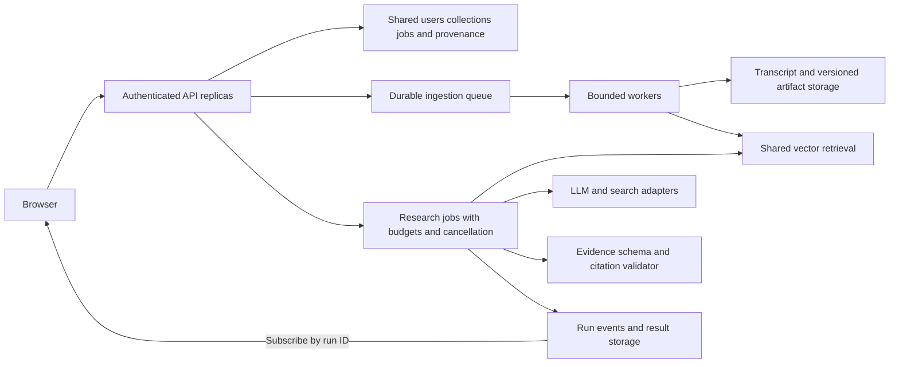

# VidSense: choices, alternatives, results, and limitations

The code establishes what was selected. It cannot establish that you personally tested every alternative. In the tables below, rationales marked as interpretation are reasonable engineering arguments, not fabricated development history.

## 1. Design decisions you should be able to defend

| Choice in the code | Why it fits this project | Alternatives and when they fit better | Cost or limitation |
|---|---|---|---|
| Existing captions as input | Timestamped text is cheap to ingest and directly searchable; no media download pipeline | ASR for videos without captions; multimodal/OCR pipeline for information on screen | Caption errors, missing languages and silent visual information are outside the current pipeline |
| Direct caption client locally, managed provider in cloud | Documented response to cloud-IP blocking; both normalize into the same segment schema | Official authorized caption access, licensed providers, user uploads, carefully operated ASR | Managed-provider dependency, quota/cost, incomplete asynchronous-response handling |
| `yt-dlp` flat playlist enumeration | Gets video IDs/titles without downloading media | YouTube Data API for supported metadata/playlist operations; managed enumeration; uploaded manifest | Scraper breakage/auth/network behavior and incomplete flat metadata |
| oEmbed title fallback | Best-effort lightweight metadata; ID fallback keeps ingestion usable | Full provider metadata; explicit user labels | Can fail, be slow, or produce IDs as titles; title quality is separate from transcript quality |
| Unified collection index | Simple cross-video search and shared metadata structure | Per-video indexes for reliable scoping; shared database with collection/video IDs for scale | Global nearest neighbors can overrepresent one video; wrapper filters a limited candidate set |
| Recursive character splitting | Simple, broadly language-tolerant splitting; overlap helps boundaries | Caption/time-window chunks for provenance; token chunks for model limits; semantic splitting for topic coherence | Character budgets are not token budgets; timestamp offsets must account for actual chunk spans |
| 1000-character chunks, 200 overlap | Practical context/size starting point; no measured optimality is evidenced | Smaller chunks for pinpoint lookup; larger windows/parent retrieval for explanatory context | Small chunks lose context, large chunks dilute embeddings; overlap duplicates content |
| Local FastEmbed/ONNX BGE embeddings | Documented lightweight CPU/runtime choice avoiding the heavy legacy ML stack | Hosted embeddings for managed quality/multilingual options; sentence-transformers for model flexibility; GPU services for volume | Local model/RAM/cold-start needs; English model; no in-project embedding benchmark |
| Batch size 16 | Documented memory safeguard for small containers | Larger batches for throughput on adequate RAM; bounded worker pools; controlled ONNX thread counts | Lower throughput; simultaneous jobs can still amplify memory usage |
| FAISS flat exact search | Simple dependency, local disk cache, excellent fit for 147 vectors | HNSW/IVF FAISS indexes for large datasets; Chroma for convenience; pgvector/Qdrant/Pinecone for shared operational storage | Local library lacks tenant/auth/job/backup features; exhaustive vector work grows with corpus size |
| Metadata-rich documents | Structured source identity travels with retrieval | Immutable chunk IDs plus timestamp ranges; separate relational provenance records | Current timestamp accuracy and duplicate identity are weak; no citation validation |
| Disk cache | Avoid repeated caption calls/embeddings; baked demo works without live fetching | Shared object storage/database, incremental per-video cache, content-addressed/versioned artifacts | Stale/duplicate caches, no disk TTL, unsafe pickle trust boundary, concurrent writes |
| LangChain wrappers/tools | Common LLM/document/tool/callback interfaces reduce provider glue | Direct SDKs for tighter control; lightweight custom typed tools | Broad dependencies, version drift, wrapper defaults and provider capability differences |
| LangGraph state machine | Explicit loop, stop condition, state merging, tracing and node updates | A custom while loop for minimal dependency overhead; fixed workflow for predictable tasks | More machinery than simple lookup needs; framework use alone does not improve answers |
| Native tool calls | Tool schemas and call IDs provide structured actions | Structured JSON plan with validation; textual ReAct parsing | Model must support tools; schema validity does not guarantee useful arguments |
| Separate planner and synthesizer | Different responsibilities; final answer can be rebuilt from accumulated evidence | Use the planner's final response to reduce a call; deterministic templates for narrow tasks | An extra LLM call; comparison narrative/interpretation is not passed into synthesis |
| Content plus artifact tool results | Human-readable observations and machine-readable provenance coexist | Parse citations from text, or define a typed response object throughout | Artifacts still need validation/versioning; web provenance isn't fully surfaced in output |
| Bounded iterative planning | Adaptive evidence collection handles diverse requests | Fixed per-task tools, query decomposition, conditional routing, stronger retrieval-only baseline | Extra calls, growing conversation context, redundant searches, final requested tool can be dropped at cap |
| Same LLM client for planner/tool/synthesis/verifier | Simple provider configuration and consistent behavior | Cheap planner/verifier plus stronger synthesis; independent verifier model; model selection by task | Correlated errors; no evidence this model mixture was optimized |
| Low temperature | Practical attempt to reduce variation in research responses | Temperature zero for tighter repeatability; higher values for creative ideation | Still not deterministic; cannot fix missing evidence or bad prompts |
| Optional Tavily verification tool | Extends research beyond what the collection says | Curated primary-source search, direct authoritative pages, specialized calculators/databases | Snippets can be weak/stale; search ranking is not fact authority; added service cost |
| Sentence-level LLM verifier | Reports potential support gaps after answer generation | Typed atomic-claim extraction, NLI model, deterministic citation checks, repair/abstention gate | No correction loop, coarse claims, JSON weaknesses, same-model bias |
| Single-shot summary/highlight path | Comments explicitly prioritize responsive customer actions | Per-video map/reduce, timeline summarization, diverse coverage retrieval, specialized highlights model | Ten chunks do not guarantee collection coverage or five distinct moments |
| FastAPI | Typed contracts, OpenAPI, static serving and streaming in one Python service | Flask for a small synchronous API; Django for accounts/admin/data-heavy product; separate worker service | Synchronous dependencies require careful offloading; global dictionaries limit architecture |
| Vanilla JS/CSS frontend | Engineering interpretation: enough UI control with no build system for a small app | React/Vue/Svelte for larger component/state ecosystems; Streamlit for internal experimentation | Global state/races, limited frontend tests and routing, CDN dependencies |
| SSE | One-way research progress maps naturally to server events | WebSocket for bidirectional live sessions; POST plus polling for robust jobs | GET query logging, no replay/cancel, whole-answer rather than token updates |
| UUID collection IDs and localStorage | Simple temporary browser reconnection without accounts | Authenticated collections in a database; signed session tokens | ID possession is access; no user ownership or durable library |
| In-process threads, locks and semaphores | Bound network-heavy work with little deployment overhead | Queue-backed workers, process pools for CPU work, native async integrations | Jobs die on restart, no scheduling durability, no distributed quotas |
| One replica, scale-to-zero | Documented portfolio cost/simplicity tradeoff matching local state | Minimum one replica for predictable availability; shared storage and multiple replicas for demand | Cold starts and session loss; new revisions need care; single replica is not durable storage |
| Runtime/dev dependency split | Keeps heavy legacy and visualization packages out of production | Separate packages/optional extras and lockfiles; multi-stage builds where appropriate | Current broad lower bounds do not reproduce a fixed dependency environment |
| Baked demo index and warmed model | Documented resilience to blocked fetching and faster cold starts | Versioned artifact download at startup; object storage; build-time ingestion in CI | Stale artifacts and clean-clone provisioning; actual cold-start numbers not measured |
| Baseline plus evaluation harness | Measures benefit/cost and reveals tool/pipeline failures | Human evaluation, independent judges, evidence recall/citation metrics, capability-matched ablations | Small hand-authored dataset and current judges do not justify universal performance claims |

For FAISS versus a database, emphasize scope: “At our demonstration scale, a local flat index made the system inspectable and cheap. For durable authenticated collections, I would externalize collection metadata and vector storage.” Do not argue that FAISS is intrinsically better than all vector databases.

PostgreSQL/pgvector is a plausible roadmap because ownership, metadata, and vectors can live in a shared transactional system. It supports exact search and approximate index options, with filtering considerations of its own. Moving to it would not automatically solve retrieval quality. [pgvector documentation](https://github.com/pgvector/pgvector).

## 2. Concepts behind the choices

### RAG versus full-context prompting versus fine-tuning

RAG gives the generator external passages at query time. In this project, those passages are embedded and retrieved from caption chunks; model weights are unchanged. It provides updateable evidence and provenance, but can fail through retrieval or synthesis errors. This is an application-level retrieve-and-generate pipeline, not the original research paper's end-to-end training recipe. [RAG paper](https://arxiv.org/abs/2005.11401).

Full-context prompting can be attractive for one short transcript: fewer components, no retrieval omission, and easier first implementation. It becomes more expensive/repetitive across long collections and repeated questions, and the model must attend to much more irrelevant content. It deserves benchmarking as an alternative, especially for summaries.

Fine-tuning changes model behavior from examples. It can help style, task behavior, or domain conventions, but is not a convenient way to add and remove individual videos with exact provenance. VidSense neither fine-tunes its generator nor trains BGE/BERT from scratch.

### Dense search versus lexical and hybrid search

Dense embeddings help paraphrases match: “adjusting weights downhill” may retrieve discussion of gradient descent. Lexical/BM25 retrieval helps exact terms, names, numbers, and quoted phrases. Combining both can improve coverage, with extra indexing/fusion complexity. A reranker can score retrieved candidates jointly with the question to improve ordering, at the cost of another model pass.

These are proposed retrieval improvements. There is no BM25, hybrid fusion, reranking, MMR, query-expansion model, or retrieval-score abstention threshold implemented in the current source.

### Semantic relevance versus evidence support

Retrieval finds nearby text representations. It does not prove that a passage contains the answer. Synthesis decides what claims to make. Verification asks whether the selected evidence supports them. All three stages need evaluation; a good nearest-neighbor implementation is not sufficient to make a correct research application.

## 3. Evaluation: what the numbers really say

Relevant code/data: [metrics](<C:/Users/saksh/OneDrive/Desktop/vidsense-gpt/vidsense/eval/metrics.py:73>), [runner](<C:/Users/saksh/OneDrive/Desktop/vidsense-gpt/vidsense/eval/runner.py:46>), [latest saved run](<C:/Users/saksh/OneDrive/Desktop/vidsense-gpt/vidsense/eval/runs/run_20260730_012915.json>).

### 3.1 Dataset

The manifest is a coherent six-video 3Blue1Brown deep-learning series: introductory neural networks, gradient descent, backpropagation intuition/calculus, GPT, and attention. That makes cross-video relationships meaningful and the task set small enough to inspect.

The current tasks are **7 single-video, 6 cross-video, and 3 external-verification tasks**. Each has a question, reference answer, expected tools, gold video IDs, and difficulty. Verification tasks mark Tavily as required, but the runner only warns when its key is missing; it does not skip those tasks automatically.

The data records difficulty and gold IDs, but current scoring does not measure difficulty slices, evidence recall against those IDs, or timestamp correctness. There are no annotated gold timestamp ranges. The timestamp question `s7` has a reference about the chain rule's role rather than a precise gold time.

### 3.2 Success score

An LLM judge compares candidate answer to reference and chooses:

- `correct`: 1.0
- `partial`: 0.5
- `incorrect`: 0.0

The aggregate called `task_success_rate` is the mean score over non-null scored rows. With partial credits, it is not necessarily the fraction of wholly correct tasks. In the final saved run all labels are binary, so it happens to equal that fraction.

The judge prompt grades factual answer completion, not a citation rubric. The saved rows omit the success judge's reason even though the metric produces one. This limits later auditability.

Parsing failures without a JSON object yield `unknown` with score zero. Invocation exceptions produce score `None`, excluded from the mean. Those are different failure treatments despite a broad “fail open” description.

### 3.3 Tool accuracy

The deterministic metric converts actual and expected tool names to sets:

```text
precision = |actual ∩ expected| / |actual|
recall    = |actual ∩ expected| / |expected|
F1        = 2PR / (P+R)
coverage  = recall
exact_set = actual == expected
```

This measures **tool-name overlap**, not correctness of arguments, order, repeated calls, tool success, or retrieved evidence. Calling a tool with the wrong video ID can receive name credit. Calling a useful `list_videos` that is absent from expected tools reduces precision. Calling `transcript_search` five times is treated like calling it once.

A good answer can score poorly if a different valid strategy was used. For instance, final-run `c2` succeeds through searches without the expected comparison tool. Use tool scores diagnostically, with optional/acceptable tool sets, argument checks, and evidence metrics in a stronger harness.

### 3.4 Trajectory quality

Another LLM judge rates efficiency, tool choice, order, and stopping from 1 to 5. The normalized value is `(score - 1) / 4`; 68.75% normalized means an average **3.75 out of 5**, not 68.75% correct actions.

The renderer shows plan tool calls/args and tool passage counts, followed by node names. It leaves out full observations, tool content, and much timing evidence. This misleads the judge for intentionally zero-passage tools.

The final run's `s7` judge says inventory returned zero passages and was redundant, even though its preview clearly lists videos. The `v2` judge says the web tool failed/returned no passages and the answer used internal knowledge, but the actual preview starts with a successful `SUPPORTED` finding. These are concrete examples of a metric's representation damaging its validity.

### 3.5 Final historical result, recomputed

The saved run completed on **30 July 2026** with agent, baseline, and judge on `gemini-3.5-flash-lite`, and Tavily enabled. It is historical evidence, not a new test of the documented Groq deployment.

| Metric | Agent | Baseline |
|---|---|---|
| Overall success | 15/16 = 93.75% | 9/16 = 56.25% |
| Single-video success | 7/7 = 100% | 5/7 = 71.43% |
| Cross-video success | 5/6 = 83.33% | 3/6 = 50% |
| Web-verification success | 3/3 = 100% | 1/3 = 33.33% |
| Average recorded latency | 34.9091 s | 5.3469 s |
| Average tokens | 9799.5 | 721.875 |
| Average executed tools | 3.6875 | 0 explicit agent tools |
| Mean grounded ratio | 94.27% | Not measured |
| Tool coverage | 81.25% | Not measured |
| Tool F1 | 58.97% | Not measured |
| Exact tool set | 18.75% | Not measured |
| Normalized trajectory quality | 68.75% | Not measured |
| Recorded total model cost estimate | $0.019763 | $0.001675 |
| Recomputed unrounded mean estimate | $0.0012351875 | $0.0001046875 |

The absolute success lift is **37.5 percentage points**. It is not simply a “37.5% improvement”: the relative increase is approximately 66.7%, and the unit matters.

The report's approximate 12× cost comparison is based on rounded means. Using totals gives about **11.8×**. The recorded latency ratio is approximately **6.53×**. These are measurements from that run's environment, including throttling, not general deployment guarantees.

“Zero baseline tool calls” means it has no explicit planner/executor tools. It still performs a vector retrieval and a model call; it does not have zero computational or external operations.

### 3.6 Cost methodology has important limits

The function computes input tokens times input price plus output tokens times output price, divided by one million. The price table has explicit entries for some Llama and older Gemini models.

It has **no entry for `gemini-3.5-flash-lite`, `gemini-3.6-flash`, or `openai/gpt-oss-20b`**. Those use the `default` price of $0.10 input/$0.40 output per million. Therefore the saved dollar estimates are internally reproducible proxy values, not verified provider invoices or model-specific current list prices.

Costs also exclude Tavily/Supadata usage, ingestion embeddings/CPU, Azure/storage, evaluation judge calls, and failed/retried attempts. Pricing for a production product must include these categories, not just the successful generator calls.

Average cost values are rounded to four decimals during aggregation, hiding substantial relative differences for very cheap calls. Saved per-task rows retain total tokens but not the input/output split from the returned usage object, so recomputing historical cost with a different price table is not fully possible from the saved rows alone.

### 3.7 Earlier runs and survivorship in averages

| Saved file suffix | Model | Tasks | Agent rows with non-null success | Agent mean success | Major interpretation |
|---|---|---|---|---|---|
| `0728_184027` | Llama 3.3 70B | 3 | 3 | 33.33% | Small early run, two partial answers; baseline mean was higher |
| `0728_185022` | Llama 3.3 70B | 13 | 7 | 50% | Six agent engine errors omitted from success average |
| `0728_201544` | Gemini 3.6 Flash | 13 | 0 | Unavailable | All 13 agent tasks errored; recorded failures are quota-related |
| `0728_223748` | Gemini 3.5 Flash-Lite | 13 | 7 | 85.71% | Six agent engine errors omitted from headline average |
| `0728_225302` | Gemini 3.5 Flash-Lite | 13 | 13 | 80.77% | Complete non-web run, with one partial answer |
| `0730_011106` | Gemini 3.5 Flash-Lite | 16 | 16 | 65.625% | All three verification tasks failed answer success |
| `0730_012915` | Gemini 3.5 Flash-Lite | 16 | 16 | 93.75% | Final complete run; all three verification tasks succeeded |

The table uses shortened filenames for readability; complete names and values appear in [audit_results.json](<C:/Users/saksh/OneDrive/Desktop/vidsense-gpt/docs/interview/audit_results.json>).

For the 85.71% run, six of thirteen requested agent tasks errored. The 85.71% is six correct answers among seven scored successes. Counting engine errors as zero would give 6/13 = **46.15%**, a very different operational outcome. The final run does not have this missing-row problem, but the harness still should report completion/error rate separately.

### 3.8 The useful debugging story

In the 01:11 saved run, verification tools were selected but final answers scored 0/3 on verification. The README describes the cause: the synthesizer only consumed transcript passages, while the external tool returned no transcript passages. Web verdicts were therefore lost at synthesis.

The current code has a separate `findings` channel and collects tool content when its artifact has `sources`. The synthesizer and claim verifier receive those findings. The following saved run scores 3/3 on verification.

This supports an interview story about tracing data contracts, repairing an evidence path, and remeasuring. Without source revision hashes or Git history, it does not establish that the code change was the sole cause of the entire overall gain. Other task outcomes changed too, and the model/judge are stochastic.

### 3.9 What the comparison cannot establish

- Generalization from 16 tasks on one educational collection to arbitrary real user data.
- Superiority of planning alone: the agent gets more retrievals, more evidence, nested generation, and a web tool the baseline lacks.
- Guaranteed inability of one retrieval to compare videos: a unified-index top-k can contain several videos; it simply does not enforce representative coverage.
- Exact timestamp accuracy: no gold timestamp metric exists, and the offline audit finds an offset bug.
- A hallucination rate from average grounded ratio: claim extraction/verifier bias and missing evidence affect it.
- An unthrottled 10-second average: the README asserts this, and a subset of an older failed run is near 9.6 seconds, but there is no controlled full-task unthrottled comparison with captured RPM in these artifacts.
- Exact reproducibility: saved runs lack code hash, dependency lock, prompt/cache fingerprint, seed, RPM, max-step settings, and full evidence/verdict snapshots.

Stronger evaluation would retain failures in denominators, use held-out collections, repeat paired runs, independently check answers/citations, measure gold passage/video/time recall, compare capability-matched baselines, and save full configuration. Start with ablations: no verifier, no comparison-generation call, higher scoped `fetch_k`, richer evidence length, and a question router. Change one factor at a time and compare quality, latency, and cost.

## 4. Verified implementation problems and how to discuss them

These are analysis findings; the runtime implementation was not modified for this request.

### 4.1 Timestamp drift — reproduced on every cached video

[Source](<C:/Users/saksh/OneDrive/Desktop/vidsense-gpt/vidsense/corpus.py:177>).

Chunks overlap, but the mapping cursor advances by full chunk lengths. It gradually gets ahead of the actual source position. The timestamp helper then clamps out-of-range positions to the final caption, causing several distinct chunks to share an end timestamp.

The offline audit finds each stored chunk's actual start in its video's joined caption text, maps that offset to the containing caption using character-start boundaries, and compares it with stored metadata. All 147 chunk starts were found.

| Video/chapter | Chunks | Distinct stored times | Largest forward drift |
|---|---|---|---|
| Neural network introduction | 23 | 20 | 198.461 s |
| Gradient descent | 25 | 22 | 231.600 s |
| Backpropagation intuition | 16 | 14 | 134.617 s |
| Backpropagation calculus | 11 | 10 | 110.015 s |
| GPT/transformers | 37 | 31 | 317.847 s |
| Attention | 35 | 29 | 317.540 s |

One GPT chunk is labeled around 1601.770 s while its text starts in a caption at 1283.923 s, a **317.847-second** discrepancy. This measures metadata against the available captions, not against frame-level audiovisual alignment.

There is also a boundary bug in `find_timestamp_for_position()`: using `accumulated >= position` assigns a position exactly at the next segment's start to the previous segment. The separate two-caption reproduction establishes that issue.

**Repair design:** record actual start/end offsets from the splitter, or build chunks directly from caption segments with explicit ranges. Use prefix character offsets plus binary search for caption mapping. A literal text search needs care for repeated phrases/whitespace normalization. Merely subtracting a fixed 200 characters is insufficient because actual overlap and separators vary. Add boundary/overlap/repeated-text checks, store chunk IDs/ranges, version the cache, rebuild existing indexes, and validate several real caption moments. Word-level exactness would require alignment beyond this repair.

**Interview phrasing:** “Source identity is structured and reliable, but the current time mapping has an overlap-offset bug. I would fix provenance mapping and rebuild the cache before advertising exact-second citations.”

### 4.2 Scoped retrieval can return zero despite existing chunks

[Source](<C:/Users/saksh/OneDrive/Desktop/vidsense-gpt/vidsense/corpus.py:102>).

The wrapper fetches twenty global neighbors before filtering by video. The offline audit found sixteen underfilled query/video combinations among five queries across six videos. This demonstrates candidate starvation, not that every fetched fallback passage is relevant.

**Repair design:** at this small scale, fetch all candidates for scoped retrieval; at larger scale, use adaptive overfetching, per-video indexing, or database-supported scoping. Measure expected passage recall and retrieval latency. Do not confuse “more results” with “better evidence.”

### 4.3 Evidence truncation and weak collection coverage

[Source](<C:/Users/saksh/OneDrive/Desktop/vidsense-gpt/vidsense/citations.py:36>), [action routing](<C:/Users/saksh/OneDrive/Desktop/vidsense-gpt/api.py:209>).

Only the first 320 characters of each retrieved chunk reach synthesis/verification, even if the answer is later in the chunk. Summaries/highlights use ten globally retrieved chunks and have no coverage enforcement. The baseline comparison uses six.

**Repair design:** use full bounded passage text, query-focused sentence windows, or parent/neighbor context; retrieve across videos for overviews; deduplicate by source span; measure coverage and avoid overlong prompts. Explicitly evaluate the summary/highlight product tasks, which the current research task set does not cover.

### 4.4 The verifier is a report, and its parser is permissive

[Source](<C:/Users/saksh/OneDrive/Desktop/vidsense-gpt/vidsense/citations.py:86>).

Verified edge cases: `"supported":"false"` yields support because a nonempty string is truthy; a non-JSON reply yields 0.0 rather than an unavailable result; very short answers produce no claims. Answers are never repaired or blocked.

**Repair design:** use structured output with strict Boolean fields and valid claim indexes; distinguish unavailable verification from unsupported claims; keep claim/source mappings; use atomic factual claims; add a calibrated abstention/repair policy with bounded additional work. Independently evaluate verification reliability before using it as a trust badge.

### 4.5 The step cap can drop an action

[Source](<C:/Users/saksh/OneDrive/Desktop/vidsense-gpt/vidsense/agent.py:146>).

The sixth planner output's calls are discarded at the default cap. The offline scripted test executes five tool rounds and six planner calls. A trajectory can contain a final requested tool that never runs.

**Repair design:** define the budget precisely—planning calls, executed tool batches, individual tool calls, tokens, and wall-clock—and stop without generating an unused request. Include the stop reason in telemetry. Parallel calls require both model support and executor changes.

### 4.6 Ollama is not a working drop-in agent provider

[Source](<C:/Users/saksh/OneDrive/Desktop/vidsense-gpt/vidsense/config.py:201>).

The old completion wrapper has no `bind_tools()`, confirmed against the installed dependency. Supporting a local LLM for baseline completion differs from supporting native tool calling in the agent.

**Repair design:** select a modern chat wrapper/model with supported tools, validate provider names and capabilities, and add a provider contract check. Keep the provider-specific timeout/retry/token-accounting behavior explicit.

### 4.7 Browser escaping corrupts apostrophes

[Source](<C:/Users/saksh/OneDrive/Desktop/vidsense-gpt/frontend/app.js:4>).

The regex matches `'`, but the object has no corresponding escape string. Node confirms `don't` becomes `donundefinedt`. This is a concrete correctness bug, independent of the potential Markdown security issue.

**Repair design:** cover all matched characters, use a well-tested sanitizer after Markdown generation, and validate URLs. Marked documents that it does not sanitize output. [Marked documentation](https://marked.js.org/).

### 4.8 Evaluation omits failures and misprices defaults

[Source](<C:/Users/saksh/OneDrive/Desktop/vidsense-gpt/vidsense/eval/runner.py:142>), [price fallback](<C:/Users/saksh/OneDrive/Desktop/vidsense-gpt/vidsense/eval/metrics.py:33>).

Engine errors are absent from aggregate scored rows. Unknown model prices silently use a generic fallback. Judge costs/retries/service/hosting costs are not counted.

**Repair design:** save completed/failed counts; report success over all attempts and conditional success over completed answers; retain input/output tokens and all attempt usage; require explicit model prices or label an estimate unavailable; record judge and external-service categories separately.

## 5. Operational and security limitations established by inspection

These are concrete architectural gaps or plausible failure modes; they were not all exercised against live infrastructure.

- **Temporary state:** collections, job state, rate quotas, and client reconnect identity are not durable server records. LocalStorage cannot fix server-state loss.
- **No authenticated ownership:** an unguessable corpus ID reduces guessing but does not associate data with a user. Anyone possessing it can use its endpoints.
- **No durable queue:** daemon-thread ingestion can disappear at restart. There are no leases, checkpoint/recovery, or cancellation states.
- **No total job deadline:** a collection can contain many slow calls; direct adapters lack the managed timeout; stuck processing entries are not expired.
- **No stream cancellation/backpressure:** workers can continue after disconnect and the queue is unbounded. Failures scheduling events into a closed loop deserve cleanup handling.
- **Concurrent cache builds:** two identical ingestion jobs can write the same files without a per-cache lock/atomic commit. `records.json`/FAISS can become inconsistent after interruption.
- **No cache capacity policy:** session TTL does not remove disk artifacts; twenty live collection entries do not cap total disk usage or all peak embedding memory.
- **Incomplete cache versioning:** model/algorithm/language changes can use old data. The legacy key should also sanitize/contain names, rather than relying only on the newer safe key.
- **Public evaluation route:** “internal” is a comment, not access control. It exposes saved task answers, trajectories, and raw recorded error strings.
- **Forwarded-header trust:** rate-limit identity trusts a request header without an application-level proxy allowlist. Quotas are neither authenticated nor distributed.
- **Untrusted-text prompts:** transcript/web content can contain instructions. There is no explicit untrusted-evidence boundary, schema-enforced answer policy, or prompt-injection regression suite. Tool allowlisting limits actions but does not make answers immune to manipulation.
- **Markdown boundary:** escaping raw HTML alone does not restrict generated links/images or their protocols. CDN assets also need dependency-integrity/control decisions.
- **Error consistency:** model failures are sanitized, but collection jobs store raw `str(exc)` in their public session error field; not all paths have the same disclosure policy.
- **Input rigor:** hostnames are checked, but video IDs are not comprehensively validated and schemes/redirect behavior are not normalized to a single canonical safe form. Collection names are trimmed after length validation, so whitespace-only names can become empty.
- **UI races:** source creation can switch the active collection while an existing stream continues; results should carry corpus/run identity and update only the matching view.
- **Incomplete provider adapter:** Supadata transcript code expects immediate `content`; it does not handle an asynchronous `jobId` response. Provider-owned reference material documents polling for such jobs. [Supadata transcript reference](https://github.com/supadata-ai/skills/blob/main/skills/supadata/references/video.md).
- **Weak deployment reproducibility:** caches are ignored by Git yet expected by Docker COPY; requirements are not locked; neither source/artifact hashes nor provider settings are captured in benchmark runs.

Discuss these as the boundaries of a portfolio deployment. Do not claim the code already supports production multi-tenancy, durable collections, distributed rate limiting, or reliable cancellation.

## 6. A production redesign you can draw



A minimal relational design could use:

- `users`: authenticated identity.
- `collections`: owner, name, state, creation/update time.
- `collection_videos`: membership/provenance, preserving deduplication rules.
- `videos` and versioned `transcripts`: source ID, language/provider/version, segment data.
- `chunks`: immutable chunk ID, transcript version, text range, caption-time range, embedding version/vector.
- `jobs`: status, attempts, lease/deadline, progress/error.
- `research_runs`: collection/version, question/mode, status, answer, verification and budget.
- `run_events`/metrics: tool outputs, usage, latency, stop reason, audit configuration.

Use authenticated ownership checks on reads and writes; vector retrieval must be scoped before exposing data. Queue workers should be idempotent: repeated delivery must not create duplicate chunks or publish half-built artifacts. Persist progress, atomically publish a ready version, and distinguish transient failures from permanently unavailable captions.

API replicas can then be mostly stateless, with distributed per-user quotas and concurrency/job budgets. SSE subscribes to a stored run rather than launching expensive work on a GET. Cancellation and reconnect become explicit operations. Keep a full-event retention policy, since storing unlimited transcript/tool/model content is expensive and can retain user data unnecessarily.

Measure before choosing the vector index: begin with exact scoped retrieval when datasets are small, then compare recall/latency under representative tenant filters before adding approximate indexing.

## 7. Improvement order that shows judgment

1. **Repair provenance:** actual offsets/ranges, chunk identity, cache version and rebuild; evaluate timestamp accuracy.
2. **Repair evidence access:** scoped retrieval candidate policy, evidence truncation, summary/highlight coverage.
3. **Make verification honest:** typed verdicts, unavailable states, explicit claim/source mapping; define bounded repair/abstention behavior.
4. **Fix user-facing correctness:** apostrophe escape, sanitizer, result/corpus association, consistent stream/result schema.
5. **Strengthen measurement:** include failed requests, exact usage categories/configuration, independent checks and stronger baselines.
6. **Control cost and latency:** route easy questions to a suitable cheaper workflow, remove redundant LLM calls, cache/query-cover where appropriate; report measured tradeoffs.
7. **Externalize state for real users:** authentication, durable jobs/collections, shared storage/limits, cancellation and operational telemetry.

This order favors accurate evidence and measurable behavior before adding more agent complexity. It is a proposed sequence, not work already completed.
