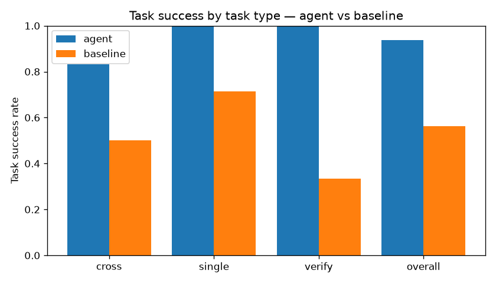
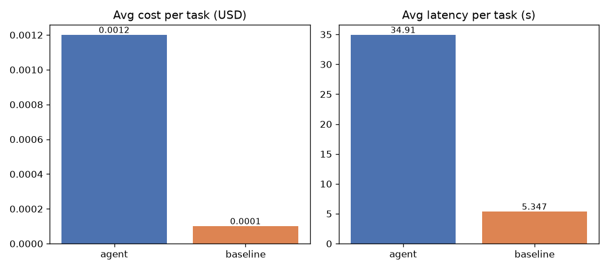

# VidSense — Agent Evaluation Report

- **Run:** `run_20260730_012915.json`  ·  2026-07-30T01:29:15
- **Corpus:** dl-series (6 videos)  ·  **Tasks:** 16
- **Agent model:** gemini-3.5-flash-lite  ·  **Judge:** gemini-3.5-flash-lite  ·  **Tavily:** True

## Aggregate metrics

| Metric | agent | baseline |
|---|---|---|
| avg_cost_usd | 0.0012 | 0.0001 |
| avg_grounded_ratio | 94.3% | — |
| avg_latency_s | 34.91 | 5.347 |
| avg_tokens | 9800 | 721.9 |
| avg_tool_calls | 3.688 | 0 |
| avg_tool_coverage | 81.2% | — |
| avg_tool_f1 | 59.0% | — |
| avg_trajectory_quality | 68.8% | — |
| task_success_rate | 93.8% | 56.2% |
| tool_exact_set_rate | 18.8% | — |
| total_cost_usd | 0.01976 | 0.001675 |

## Headline: agent vs single-shot RAG

- **Task success:** 93.8% (agent) vs 56.2% (baseline) → +37.5 pts
- **Cost:** $0.00120 vs $0.00010 per task → 12.0× more expensive
- **Latency:** 34.9s vs 5.3s → 6.5× slower

### Success rate by task type

| Task type | agent | baseline |
|---|---|---|
| cross | 83.3% | 50.0% |
| single | 100.0% | 71.4% |
| verify | 100.0% | 33.3% |

> Read this table, not just the headline: the agent's planning + tools pay off on **cross-video** synthesis and **verify** tasks (which need a web tool the baseline lacks entirely), while single-shot RAG stays competitive and far cheaper on simple **single-video** lookups. The honest design conclusion is to **route by task type**.

## Charts

## Per-task detail

| Task | Type | Agent | Baseline | Agent tools | Traj |
|---|---|---|---|---|---|
| s1 | single | 1 | 1 | list_videos,transcript_search | 25.0% |
| s2 | single | 1 | 1 | list_videos,transcript_search | 100.0% |
| s3 | single | 1 | 1 | list_videos,timestamp_lookup,transcript_search | 75.0% |
| s4 | single | 1 | 1 | list_videos,transcript_search | 25.0% |
| s5 | single | 1 | 1 | list_videos,transcript_search | 75.0% |
| s6 | single | 1 | 0 | list_videos,transcript_search | 50.0% |
| s7 | single | 1 | 0 | list_videos,timestamp_lookup,transcript_search | 50.0% |
| c1 | cross | 1 | 1 | cross_video_compare,list_videos,transcript_search | 75.0% |
| c2 | cross | 1 | 0 | list_videos,transcript_search | 100.0% |
| c3 | cross | 1 | 1 | list_videos,transcript_search | 75.0% |
| c4 | cross | 1 | 0 | cross_video_compare,list_videos,transcript_search | 75.0% |
| c5 | cross | 0 | 0 | list_videos,transcript_search | 75.0% |
| c6 | cross | 1 | 1 | cross_video_compare,list_videos,transcript_search | 100.0% |
| v1 | verify | 1 | 0 | external_verify | 100.0% |
| v2 | verify | 1 | 0 | external_verify | 50.0% |
| v3 | verify | 1 | 1 | external_verify | 50.0% |